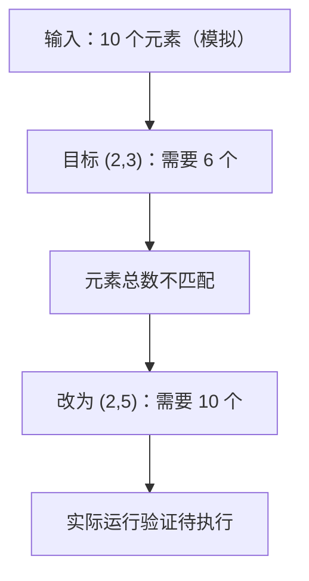

# 模拟笔记：reshape 元素总数不匹配

## 来源与上下文

- 完全虚构的教学示例；不代表用户今天的代码或报错

模拟场景：10 个元素被重塑为只有 6 个位置的张量。

## 原始报错

```text
模拟预期异常，未实际执行：RuntimeError: shape '[2, 3]' is invalid for input of size 10
```

## 修改前代码

```python
x = torch.arange(10)
y = x.reshape(2, 3)
```

## 修改后或当前代码

```python
x = torch.arange(10)
y = x.reshape(2, 5)
```

## 代码差异

```diff
--- before
+++ after
@@ -1,2 +1,2 @@
 x = torch.arange(10)
-y = x.reshape(2, 3)
+y = x.reshape(2, 5)
```

## 原因与不确定项

依据示例代码可知输入有 10 个元素，而 2×3=6；reshape 要求重塑前后元素总数一致。

## 验证记录

未执行 PyTorch。仅核对元素总数：2×5=10；不能据此宣称真实环境已修复。

## 流程图



## 关键知识

- reshape 前后元素总数必须一致。
- 可用一个 -1 维度推导形状，但其余维度应与元素总数兼容。
- reshape 不保证返回结果总是与原张量共享存储。

## 复习问答

### 1. 张量 reshape 前后必须保持哪个量不变？

元素总数。

### 2. 10 个元素能否 reshape 为 (2,3)？为什么？

不能。目标形状只有 2×3=6 个位置，与 10 个元素不一致。

### 3. 10 个元素 reshape 为 (2,-1) 时，推导出的第二维是多少？

5，因为 10÷2=5。
